# CDAW

A native Windows DAW for recording, songwriting, MIDI production, editing and mixing.
Built in C++20 on [JUCE](https://juce.com) and [Tracktion Engine](https://github.com/Tracktion/tracktion_engine).

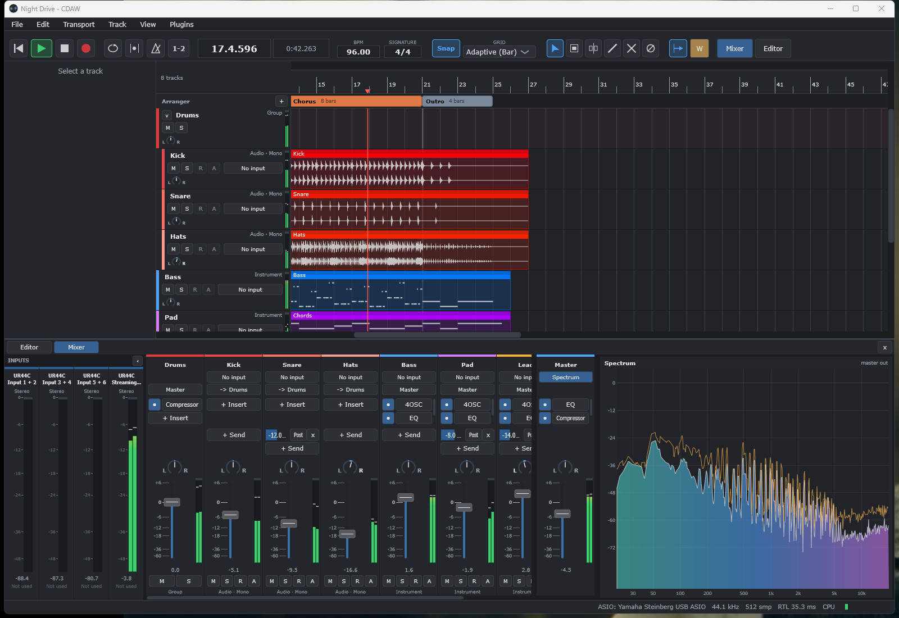

## Features

**Recording**
- ASIO and Windows Audio (WASAPI); ASIO is picked by default when present.
- Audio and MIDI recording with punch in / out, count-in and metronome.
- Record arm, input choice and monitor modes per track; latency shown in the status bar.
- Mono and stereo audio tracks: a mono track records one input channel and plays it centred (pannable), a stereo track records an input pair. Inputs are paired and split as you choose them.

**Takes and comping**
- Recording over something already on a track keeps it: audio or MIDI, looped or not, the passes become takes on
  lanes under the track (T shows or hides them), and the old pass stays quiet while the new one is recorded. The new
  pass plays where it was recorded and the old one either side of it. Passes don't need to be the same length.
- Swipe across a lane to comp that take in, click a lane to use it for the piece under the mouse, or step through
  takes with Ctrl+Down / Ctrl+Up. Joins get short fades; pieces back on one take rejoin into one clip. Takes move,
  copy and undo with their clip, and the choice stays open until you flatten (Edit > Takes).
- For MIDI, what happens when recording over a clip can be changed in Preferences > Recording: new take (the
  default), overdub into the clip, or replace it.

**Group editing**
- Click G on a folder or group track, or select tracks and press Ctrl+Shift+G, to edit its tracks as one: a drum kit
  split over 16 tracks stays in phase. Clips lined up across the tracks select together, so moving, deleting, muting,
  nudging, duplicating and the rest of a selection's commands reach all of them; trimming, fades, clip gain and slip
  edits follow on them too. Splits, ranges and comping on a take lane go through the whole group.

**Arranging and editing**
- Audio, instrument, FX, group and folder tracks.
- Clips: move, copy, trim, split, duplicate, slip edit, clip gain, fades with selectable shapes, crossfades, looped MIDI clips.
- Arranger track with song sections (Intro, Verse, Chorus...) that move, copy and repeat everything in their range.
- Piano roll and drum editor with drum maps; MIDI import and export.
- Automation lanes (draw, edit, bend; Read / Touch / Latch / Write), tempo and time-signature changes, markers.
- Undo (200 steps), autosave and crash recovery.

**Songwriting**
- Save New Version (Ctrl+Alt+S): `Song_02`, `Song_03` ... next to the song in its folder, sharing its audio, each
  with a note on what changed. File > Versions lists them with their dates and notes and opens any of them.
- Notes and lyrics (F4): a notepad for the song, and the lyrics of each song section on a lyric sheet that follows
  playback. Lyrics belong to their section, so they move and copy with it; hover a section to read them.
  Copy Lyric Sheet puts them all on the clipboard.
- Song key and scale (in the transport bar): the piano roll shades the notes outside it and marks the key's notes
  on its keyboard; Snap to Key keeps drawn and dragged notes in it, and Up / Down move notes by scale steps.
  Major and minor, the modes, harmonic and melodic minor, Phrygian dominant, Hungarian minor, pentatonics and blues.
- Project templates (File > Save as Template, File > New from Template) and track presets (right-click a track):
  the tracks, groups, routing, sends, FX returns and plugins with their settings, without clips, markers, sections
  or automation. A preset's sends find their FX return by name in the song they go into.
- Audio that has moved is found again when a project opens; anything still missing is reported and can be pointed at by hand.

**Mixing**
- VST3 instruments and effects, scanned out of process so a crashing plugin can't take CDAW down.
- Mixer with inserts (drag one by its name to reorder them), pre / post sends, FX returns, groups, master strip, level meters with dB scales and a spectrum analyser on the master.
- An Inputs section in the mixer shows the level of every audio input and which tracks use it.
- Sidechain for compressors.
- Built-in effects: 8-band EQ, filter, compressor, multiband compressor, de-esser, distortion, two reverbs, delay, chorus and phaser (below).
- C-Synth, a wavetable synth for pads and atmospheres, with 21 presets (below).
- C-Lead, a virtual analog synth for leads (hard sync, FM, a screaming ladder filter, glide and vibrato), with 20 presets (below).

**Exchange**
- Export mixdown and stems to WAV, FLAC, OGG and MP3, of the whole song, the loop range, the selected range or from / to positions you type; freeze tracks. A stem is its track after its own fader, before its group and the master; an FX return's stem is what's sent to it, returned, so stems of a mix without group or master processing add up to the mix.
- Loop range: drag in the ruler's middle strip to draw it, drag its edges to change it, drag inside it to move it; double-click switches looping on and off.
- [DAWproject](https://github.com/bitwig/dawproject) import and export, to move songs to and from Cubase, Bitwig, Studio One and others.
- Cubase project import: opens Cubase 10.5 `.cpr` files directly, with tracks, audio, MIDI, the mixer and plugin settings (below).
- C-Verb, C-Multicomp, C-Comp, C-Esser, C-Delay, C-Chorus, C-Phaser, C-Filter, C-Dist, C-Synth and C-Lead also build as VST3s for use in other DAWs.

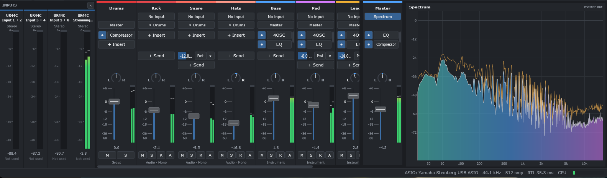

## Example project

**Night Drive** is a one-minute synth-pop song in A minor at 96 BPM, made only from what ships with
CDAW: synthesised drum stems, 4OSC bass, pad and a supersaw lead, and the built-in EQ, compressor and
C-Verb. It shows song sections, a drum group with a compressor, an FX return and filter automation. It
isn't included in the repository; generate it with the test project:

```powershell
$env:CDAW_MAKE_EXAMPLE = "$env:USERPROFILE\Documents\CDAW Projects"
.\scripts\build.ps1 -Target CDAW_Tests -Test
```

Then open `Night Drive.cdaw` in CDAW. A preview mixdown is written to its `Bounces` folder.

The same run also builds **Night Drive v2**: the same song with its pad on C-Synth (Warm Horizon, its
filter sweep automated on C-Synth's cutoff) and its lead on C-Lead (Supersaw Anthem). A project whose
folder already exists is left as it is.

**Harbour Lights** is a 90-second song in D minor made the way a song gets made in CDAW, and a test of
the whole program. Its drums (four tracks in a group), guitar and bass are really recorded, through a
fake audio interface: over each other, looped and punched in, so its take lanes are full and its drums
are comped with group editing. It has song sections with lyrics, a copied chorus, most of the built-in
effects, FX returns, automation and a slower outro. Building it also reads back everything that comes
out of it (every export format, normalising, stems, MIDI, DAWproject, versions, templates, a moved
project folder) and fails if anything is off. Its mix and stems end up in `Bounces`.

```powershell
$env:CDAW_MAKE_DEMO = "$env:USERPROFILE\Documents\CDAW Projects"
.\build\ninja-msvc-relwithdebinfo\Tests\CDAW_Tests_artefacts\RelWithDebInfo\CDAW_Tests.exe "Demo project"
```

## Built-in effects

The C- effects and synths are also plugins for any host, developed in their own repository:
[cdaw-plugins](https://github.com/CycyXX/cdaw-plugins).

| | |
|---|---|
| **EQ**: 8 bands (low / high cut at 6-48 dB/oct, shelves, peak, notch) drawn over a live spectrum. Drag a node for frequency and gain, mouse wheel for Q. | 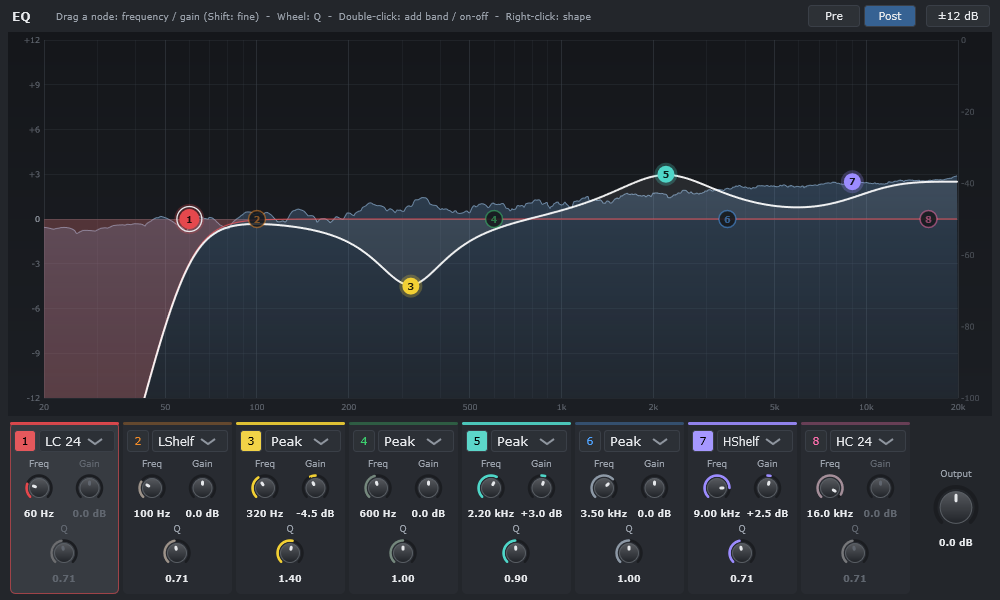 |
| **C-Comp**, the compressor: soft knee, sidechain, input / output / gain-reduction meters, the transfer curve with a live dot and a scrolling level history. | 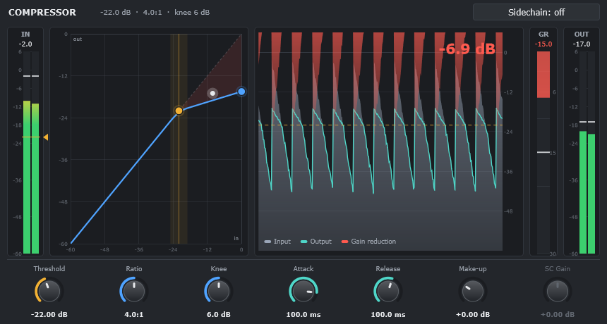 |
| **C-Multicomp**, the multiband compressor: 4 bands with phase-aligned 24 dB/oct crossovers you drag on a live spectrum; a compressor, solo and bypass per band, gain reduction per band. | 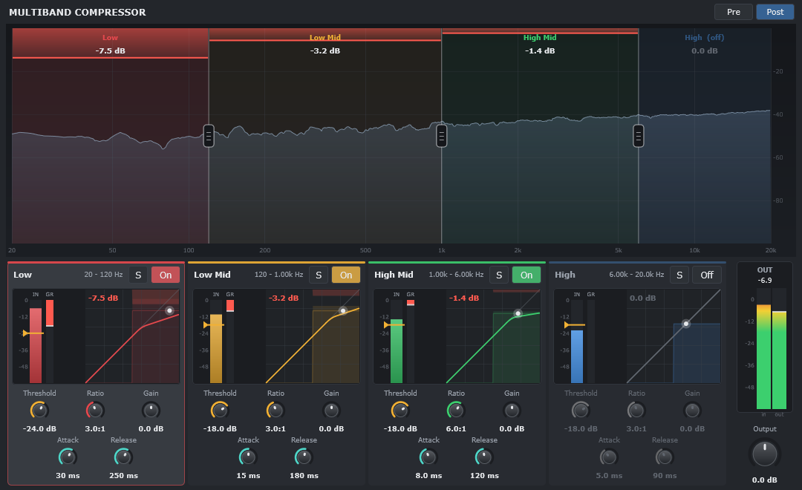 |
| **C-Esser**, the de-esser: the sibilant band you choose (drag its edges, or its middle to move it) drives a fast detector; above the threshold it turns down by up to the range, either just that band (split: a bell that dips only while there's sibilance) or the whole signal (wideband). Auto lets the threshold follow the singer's level. Listen plays the band it hears, or what it takes away. Shows the band with the reduction as it happens, and the band's level scrolling past the threshold with the reduction above it. | 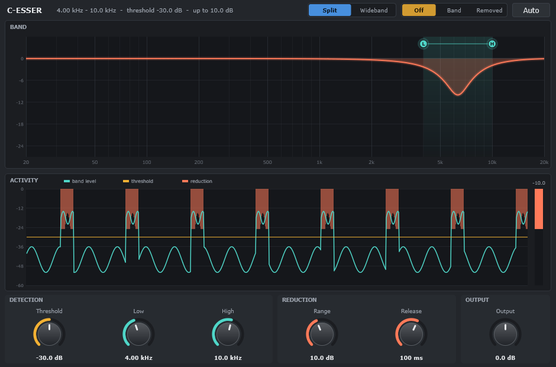 |
| **C-Verb**: early reflections, diffusion and an 8-line modulated delay network with separate decay times for lows, mids and highs; pre-delay, width, freeze, and low / high cuts before and after the reverb. The decay map shows how long each frequency rings. | 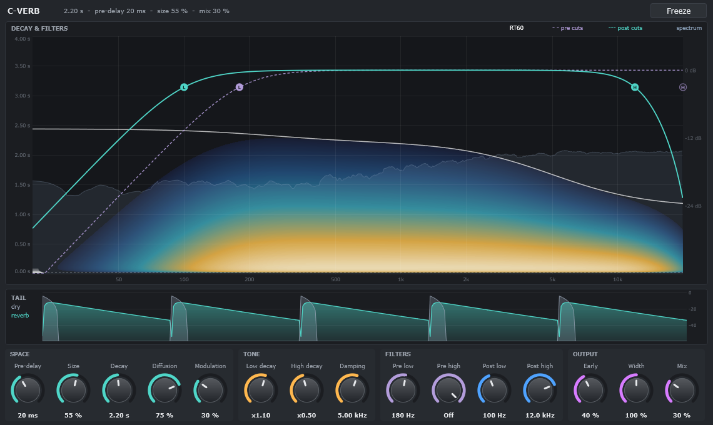 |
| **Reverb**: the quick one, with the same engine as C-Verb behind five controls: size, decay, pre-delay, tone and mix. | 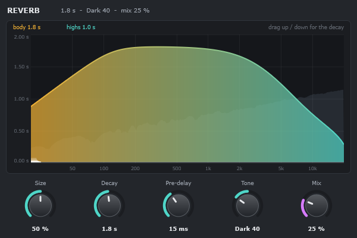 |
| **C-Delay**: stereo or ping-pong, free or in notes; low / high cuts and drive inside the feedback loop, tape wobble, ducking under the dry signal, width. The echo map shows each repeat on its side, as loud as it plays, and lights it up as the sound reaches it; drag the first echo for the time, the second for the feedback. | 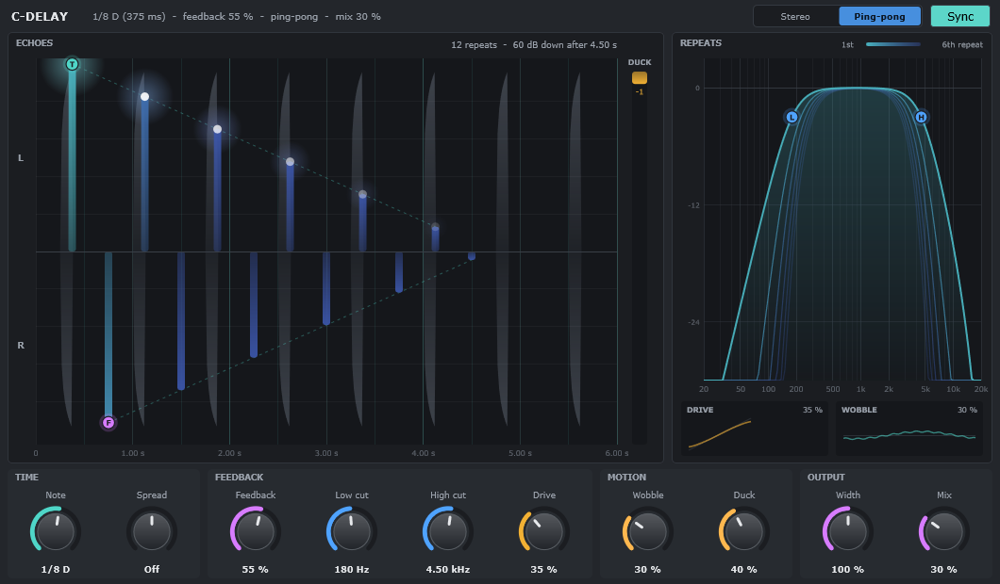 |
| **C-Chorus**: one to four voices, each on its own LFO, with stereo spread, feedback (for flanging) and tone; Chorus, Ensemble, Flanger and Vibrato starting points. Shows the voices' sweeps, the voices as sources moving towards and away from you (blue when coming closer, red when moving away: the Doppler shift a chorus is made of), and the comb filter they make. | 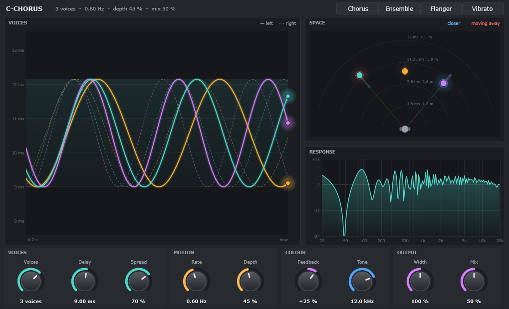 |
| **C-Phaser**: 2 to 12 stages swept around a centre, free or in notes, with feedback and stereo spread. Shows the response with its notches and the sweep range (drag the centre and the edges), and a sonogram of the sweep scrolling under it. | 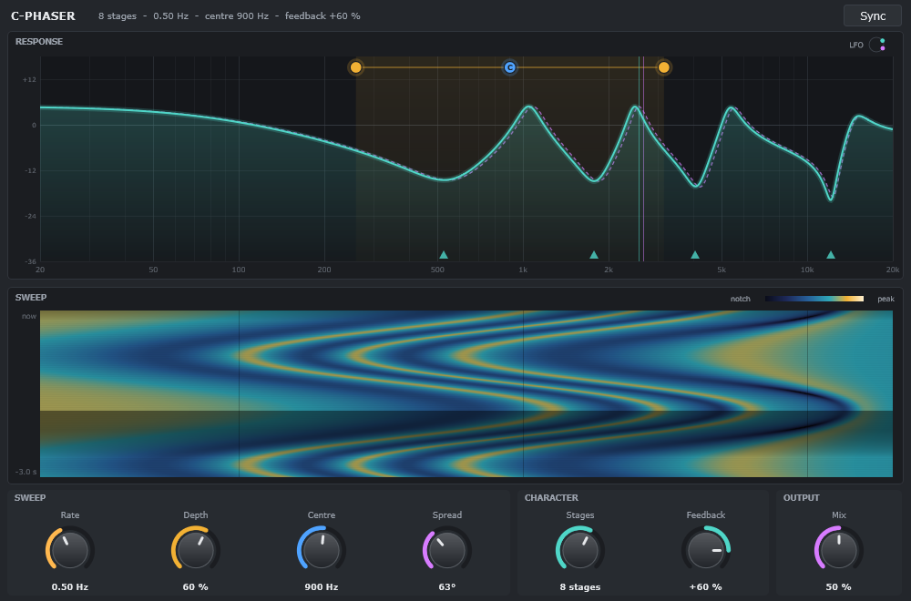 |
| **C-Filter**: low pass, high pass, band pass or notch at 12 or 24 dB/oct, resonance and drive; an LFO (six shapes, free or in notes, offset on the right side) and an envelope follower move the cutoff. Shows the live curve over the output's spectrum with a trail as it moves, and the cutoff's path over the last seconds. | 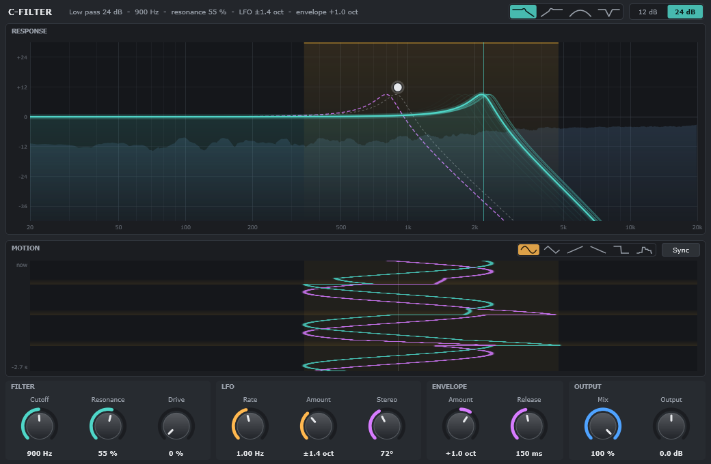 |
| **C-Dist**: a distortion pedal voiced after modern guitar amps, in six voicings: Boost (glassy, edge of breakup), Crunch (British, uneven), Lead (mid-humped, singing), Modern (three tight stages of high gain), Fuzz (starved by Character, so tails sputter) and Bass (the lows under the crossover stay clean). A noise gate before it; Tight, Character (bias: even harmonics, and the bloom of playing harder); bass, mid, treble and smooth after it; blend and level, with the level kept steady as the drive goes up. The stages run at four times the rate, anti-aliased, so high notes stay clean (it adds 41 samples of latency, reported to the host). Shows the Forge (the curve bending the wave, the real samples glowing on it, the input under it, the output beside it), Embers (what the drive added to the spectrum, as flames), the circuit with each stage glowing as hard as it clips, the gate and the tone curve to drag. 20 presets, and your own. | 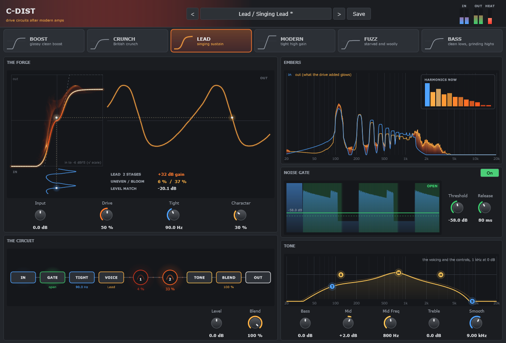 |

Projects with Tracktion's own delay, chorus, phaser or low / high-pass filter (from earlier builds)
open with C-Delay, C-Chorus, C-Phaser and C-Filter in their place, set to sound as close as possible.
LFOs keep in step with the song: synced ones follow the beats, free ones pick up the song position
when playback starts, so a bounce sounds like playback.

## C-Synth

A polyphonic wavetable synth made for pads and atmospheres (Track > Add Instrument Track > C-Synth).

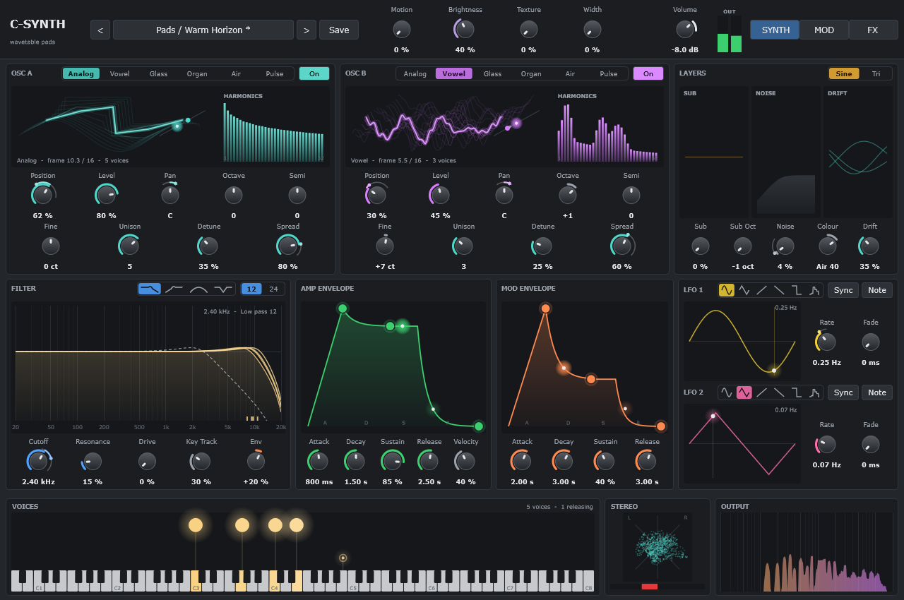

- **Two wavetable oscillators**, each morphing through a bank of 16 frames: Analog (sine to
  triangle to saw to square), Vowel (A E I O U formants, for choirs), Glass, Organ (drawbar
  registrations), Air and Pulse (PWM). Up to 7 unison voices each, detuned and spread across the
  stereo field. The tables are band-limited per octave, so high notes don't alias.
- **Layers**: a sub oscillator, noise from dark to airy, and drift (a slow analog wander of pitch
  and cutoff per voice).
- **Filter**: low / high / band pass or notch at 12 or 24 dB/oct, with drive, key tracking and its
  own envelope amount.
- **Movement**: amp and mod envelopes (up to 20 s), two LFOs (per note or shared, free or in notes,
  with fade-in), an 8-slot modulation matrix and 4 macros the presets name (Motion, Brightness...).
- **Voice**: up to 16 voices, mono or legato with glide; pitch bend, mod wheel, aftertouch, sustain pedal.
- **Effects**: chorus, delay and reverb, the engines of C-Chorus, C-Delay and C-Verb.
- **Presets**: 21 built in (pads, atmospheres, textures, keys), level-matched; save your own with
  Save (kept in `%APPDATA%\CDAW\Presets\C-Synth`, shared by CDAW and the VST3).

What it shows while it plays: each oscillator's wavetable as a stack of frames with the frame playing
now lit and where each voice's modulation has taken it; the harmonics of that frame; every voice's
filter curve, coloured by how open it is; a dot per voice on each envelope; the LFOs' positions; what
each matrix slot adds right now and over the last seconds; a ring on every modulated knob showing its
range and its value now; a keyboard with an orb over each sounding key (as bright as it is loud,
fading as it releases); the stereo image and the output spectrum.

| | |
|---|---|
| 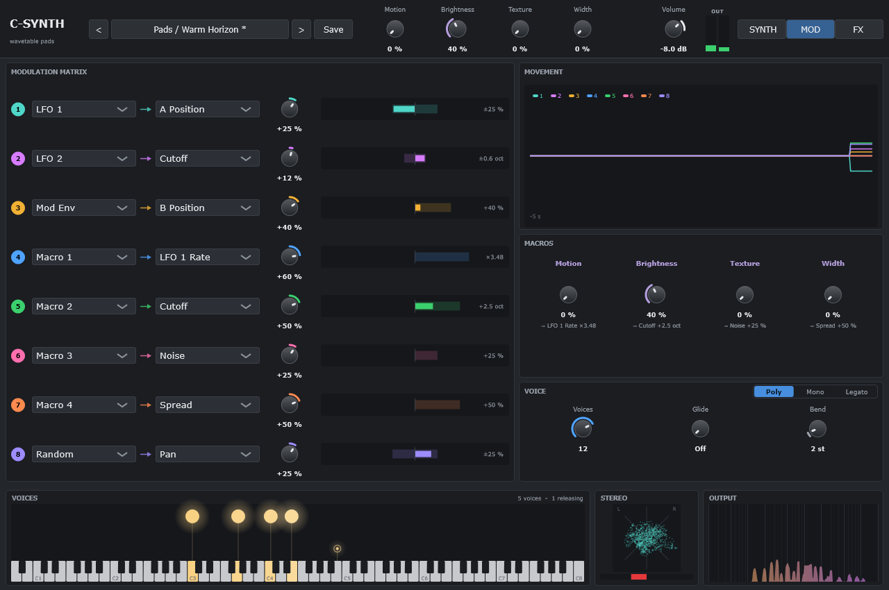 | 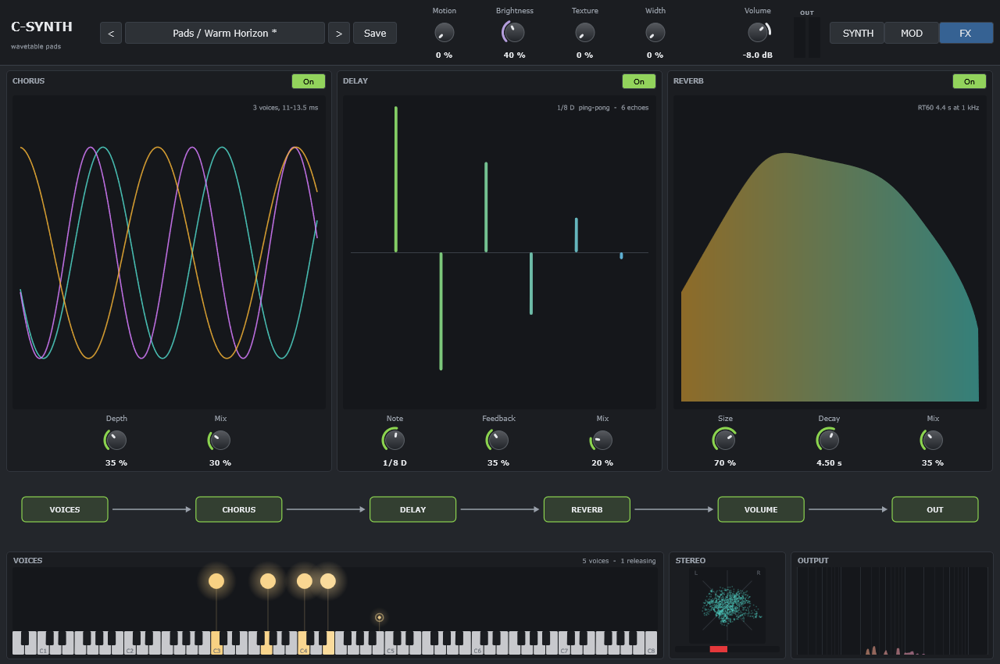 |

## C-Lead

A virtual analog synth made for leads (Track > Add Instrument Track > C-Lead).

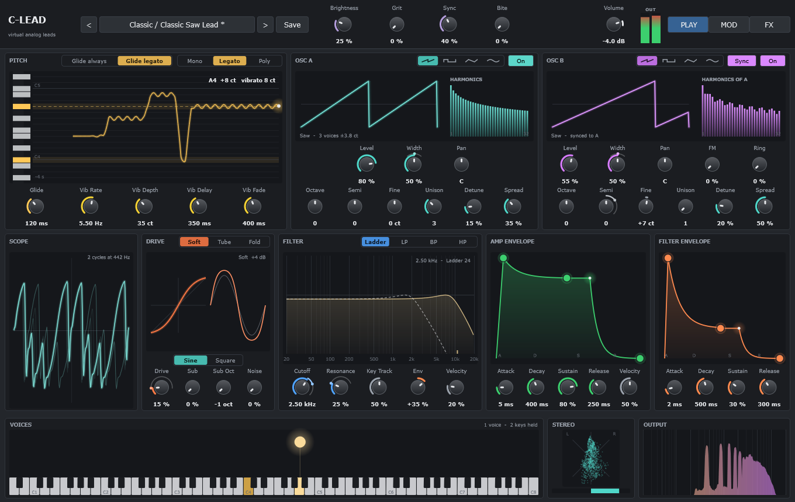

- **Two oscillators**: saw, pulse (with width and PWM), triangle and sine, up to 7 unison voices each
  for supersaws. Oscillator B can be **hard-synced** to A, **frequency-modulated** by A and
  **ring-modulated** with it. A sub (sine or square, one or two octaves down) and noise. The voices
  run at twice the sample rate with band-limited edges (sync resets included) and are filtered back
  down, so bright, synced and driven sounds stay clean.
- **Drive** before the filter: soft, tube (uneven halves, for even harmonics) or folding.
- **Filter**: a 24 dB ladder that screams and self-oscillates at the top of its resonance, or 12 dB
  low / band / high pass; key tracking, its own envelope and velocity.
- **Playing**: mono (default), legato or poly (up to 8 voices); note priority last / high / low, with
  releasing a key falling back to one still held; glide in a set time, always or only between held
  keys; a vibrato with delay and fade-in, deepened by the mod wheel and aftertouch; bend range up and
  down.
- **Movement**: amp and filter envelopes, two LFOs, an 8-slot modulation matrix (pitch, pulse width,
  sync pitch, FM, cutoff, drive...) and 4 macros the presets name (Brightness, Grit, Sync, Bite...).
- **Effects**: a distortion (C-Dist's Crunch, Lead, Modern and Fuzz circuits, with drive, tone and
  mix; 41 samples of latency while it's on), chorus, a ping-pong delay ducked under the lead, and reverb.
- **Presets**: 22 built in (classic, sync and FM, character, plucks and keys, bass), level-matched;
  save your own with Save (kept in `%APPDATA%\CDAW\Presets\C-Lead`, shared by CDAW and the VST3).

What it shows while it plays: the pitch playing now, scrolling past a keyboard on its side, so glides,
vibrato (and when it starts) and bends draw themselves, with the keys held as lanes and the note the
voice is heading for; a phase-locked scope of the voice before the effects; each oscillator's wave as
it plays (B shaped by sync, FM and ring, live with their modulation) and its harmonics; the drive's
curve with a sine through it; every voice's filter curve; a dot per voice on each envelope; the
matrix, LFOs and macros; modulation rings on the knobs; and a keyboard with an orb at each voice's
pitch, sliding along the keys as it glides.

| | |
|---|---|
| 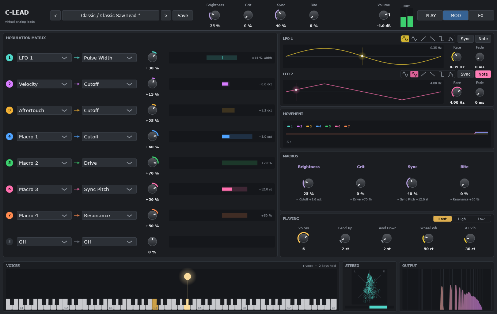 | 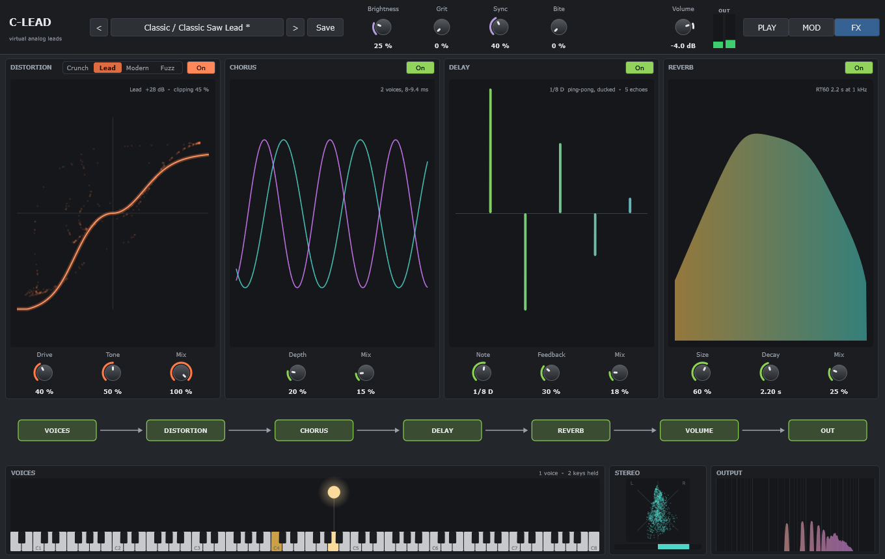 |

<details>
<summary>Piano roll and drum editor</summary>

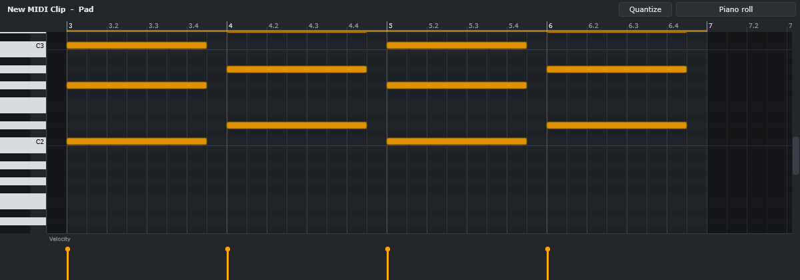
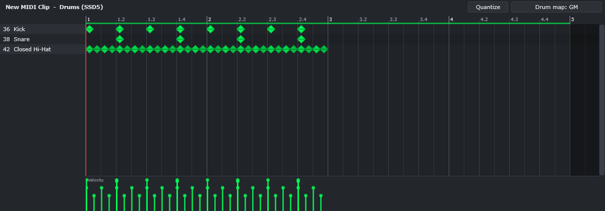

</details>

## Status

Built and checked by an automated test suite (3,400+ checks: engine, editing, recording plumbing,
DSP accuracy of the built-in effects, DAWproject round trips, UI snapshots) and launch tests on a
Steinberg UR44C.

**Not yet verified on real hardware**: live recording and monitoring latency, loop-take capture,
USB keyboard into drum and synth plugins, multi-output drum routing. See `docs\manual-tests.md`.

**Not built**: multi-output instrument routing into separate mixer channels, MIDI learn, CC lanes in
the piano roll, an audio time-stretch UI, a clip launcher, control surfaces.

## Getting started

### Prerequisites (one time)

```powershell
.\scripts\setup-toolchain.ps1   # MSVC Build Tools 2022, CMake, Ninja (accept the admin prompt)
.\scripts\bootstrap.ps1         # Tracktion Engine (pinned) + JUCE submodule
```

You don't need the Visual Studio IDE: the Build Tools package is only the compiler and the Windows SDK.

### Build and run

Double-click `Build-CDAW.bat`: it builds CDAW and puts it in `dist\`.
Start `dist\CDAW\CDAW.exe`.

Or from PowerShell:

```powershell
.\scripts\build.ps1                         # RelWithDebInfo (the build that ships)
.\scripts\build.ps1 -Target CDAW_Tests -Test   # build and run the automated tests
.\scripts\build.ps1 -Preset ninja-msvc-debug
.\build\ninja-msvc-relwithdebinfo\Source\CDAW_artefacts\RelWithDebInfo\CDAW.exe
```

The first build compiles all of JUCE and Tracktion Engine and takes a while; later builds are
incremental. VS Code with the CMake Tools extension picks up `CMakePresets.json` directly.

## Where things live

| What | Where |
|---|---|
| App settings, key mappings, recent projects | `%APPDATA%\CDAW\CDAW.settings` |
| Engine settings, audio device, plugin list | `%APPDATA%\CDAW\Settings.xml` |
| Logs | `%APPDATA%\CDAW\Logs` |
| Crash reports | `%APPDATA%\CDAW\Crashes` |
| Your drum maps | `%APPDATA%\CDAW\DrumMaps\*.txt` |
| Project templates, track presets | `%APPDATA%\CDAW\Templates\*.cdawtemplate`, `%APPDATA%\CDAW\TrackPresets\*.cdawtrack` |
| Projects (default) | `Documents\CDAW Projects\<Song>\` |

A project is a folder holding `<Song>.cdaw` (and its versions, `<Song>_02.cdaw` ...), an `Audio\` folder with
recordings and imported files, `Bounces\`, `MIDI\`, `Backups\` (the last ten saves of each version) and a
`Cache\` folder that is safe to delete. The `.cdaw`
file is Tracktion Engine's edit XML under CDAW's own extension. Projects from earlier builds
(`<Song>.tracktionedit`) are converted when opened, and the old file is moved to `Backups\`.
CDAW registers `.cdaw` with Windows for the current user, so double-clicking a project opens it.

## DAWproject

**File > Export DAWproject...** writes the open project as a `.dawproject` (format 1.0): one zip
holding the arrangement, the mixer, the audio files and each VST3 plugin's settings as a
`.vstpreset`. **File > Import DAWproject...** creates a new CDAW project from one, extracting its
audio into `Audio\Imported\`.

What carries over both ways:
- Tracks: audio, instrument, FX returns, groups and folders, with names and colours.
- Mixer: volume, pan, mute, solo, routing into groups, and pre / post sends.
- Audio clips with offset and fades, and MIDI clips with notes and loop range.
- VST3 plugins with their full state. The built-in compressor and EQ map to the format's generic
  Compressor and Equalizer.
- Volume, pan and plugin automation.
- Tempo and time-signature changes, and markers.

Some things have no equivalent in the format: clip gain, reversed clips, clip speed, takes (what's playing is exported),
sidechain routing, and the other built-in effects. Song sections are exported as markers. VST2,
CLAP and AU plugins aren't supported on import, and a plugin that isn't installed is skipped.
All of these are listed in a report after each import or export.

## Cubase projects

**File > Import Cubase Project...** creates a new CDAW project from a Cubase project file (`.cpr`).
The audio files the project uses are copied into `Audio\Imported\`; the Cubase project is only
read. Cubase's format isn't documented: CDAW's reader was worked out from Cubase 10.5 projects
(see `Source\Model\CubaseArchive.h`), so other versions may come across less completely.

What comes across:
- Tracks: audio, instrument, group and FX channels, folders, names. A folder whose tracks all
  feed the one group channel inside it becomes a CDAW group; other groups become bus tracks the
  same tracks are routed to.
- Audio events with offset, length, fades and event volume; muted events as muted clips. Where
  events overlap (stacked takes), the one on the lowest lane plays, as in Cubase; takes that are
  completely covered are left out.
- Frozen tracks come in unfrozen: their plugins run live.
- MIDI parts: notes, controllers, pitch bend and channel pressure.
- Mixer: volume, pan, mute, output routing, pre / post sends to FX channels, Stereo Out.
- Insert and instrument plugins (VST3, or a VST2 Cubase used whose VST3 version is installed)
  with their settings.
- Cubase's own effects, which only run inside Cubase, as CDAW's built-in ones with their settings
  (below).
- Volume and pan automation, tempo and time-signature changes, markers.

Cubase's own effects are replaced by CDAW's where there is one. Where it sounds the same, always:

| Cubase | CDAW |
|---|---|
| Frequency | EQ: every band with its type, frequency, gain and Q (96 dB/oct cuts become 48 dB/oct) |
| Compressor | C-Comp |

Before importing, CDAW asks whether to also use effects that only sound similar. Those are listed
in the report, so you can listen to them:

| Cubase | CDAW |
|---|---|
| Tube Compressor, VintageCompressor | C-Comp (without the tube drive and character, or the punch mode) |
| Limiter, Brickwall Limiter, Maximizer | C-Comp as a limiter (no lookahead: the fastest peaks get through) |
| DeEsser | C-Esser |

The other effects (Gate, EnvelopeShaper, Tremolo, Pitch Correct, ...) are left out, as are plugin
automation, VariAudio / AudioWarp, comping lanes, chord and arranger tracks, and rack instruments
for MIDI tracks. Each import ends with a report of what didn't come
across. If the project was moved since it was saved, its audio is looked for in the `.cpr`'s
folder.

## The C- plugins as VST3s

C-Verb, C-Multicomp, C-Comp, C-Esser, C-Delay, C-Chorus, C-Phaser, C-Filter, C-Dist, C-Synth and C-Lead also build as VST3s
(`C-Verb.vst3`, `C-Multicomp.vst3`, `C-Comp.vst3`, `C-Esser.vst3`, `C-Delay.vst3`, `C-Chorus.vst3`, `C-Phaser.vst3`,
`C-Filter.vst3`, `C-Dist.vst3`, `C-Synth.vst3`, `C-Lead.vst3`) for Cubase and other hosts. To install them, run
`.\scripts\install.ps1` in [cdaw-plugins](https://github.com/CycyXX/cdaw-plugins). It puts them in
`C:\Program Files\Common Files\VST3\CDAW`, the folder hosts scan for VST3 plugins (Windows asks for
administrator approval once; if you decline, it goes to `%LOCALAPPDATA%\Programs\Common\VST3\CDAW`
instead). In Cubase, open Studio > VST Plug-in Manager and rescan (or restart Cubase); C-Verb appears
under Reverb, C-Multicomp, C-Comp and C-Esser under Dynamics, C-Delay under Delay, C-Chorus and C-Phaser under
Modulation, C-Filter under Filter, C-Dist under Distortion, and C-Synth and C-Lead among the instruments (Synth). Close Cubase before installing, as it keeps loaded plugins
locked. C-Comp's sidechain is the host's sidechain input: route a source to it in the host, then
switch Sidechain on in the plugin (the sidechain button). Synced delay times and LFOs follow the
host's tempo and position.

The plugins live in [cdaw-plugins](https://github.com/CycyXX/cdaw-plugins), which CDAW has as a
submodule in `third_party\cdaw-plugins`. To change one, commit and push there first, then commit the
new submodule version here. `scripts\update-plugins.ps1` moves the submodule to the latest `main`, then rebuilds
and publishes CDAW, leaving the move staged for you to commit. `scripts\publish.ps1` warns if the submodule isn't the
latest `main`, and refuses if it has uncommitted changes. CDAW still builds the VST3s because its tests compare
against them, but it doesn't install them. Each plugin's CDAW build and VST3 compile the same code in that
repository's `Shared` folder, so a change there applies to both once CDAW's submodule has moved. The DSP, parameters,
editor and VST3 glue below are in the submodule, and the CDAW glue is here:

| | DSP | Parameters | Editor | CDAW glue | VST3 glue |
|---|---|---|---|---|---|
| C-Verb | `ReverbEngine` | `CVerbParameters` | `CVerbView` | `ReverbPlugin`, `ReverbEditor` | `VST3\CVerb\CVerbProcessor.*` |
| C-Multicomp | `MultibandEngine` | `MultibandParameters` | `MultibandView` | `MultibandPlugin`, `MultibandEditor` | `VST3\CMulticomp\CMulticompProcessor.*` |
| C-Comp | `CompressorEngine` | `CompressorParameters` | `CompressorView` | `CompressorPlugin`, `CompressorEditor` | `VST3\CComp\CCompProcessor.*` |
| C-Esser | `EsserEngine` | `EsserParameters` | `EsserView` | `EsserPlugin` | `VST3\CEsser\CEsserProcessor.cpp` |
| C-Delay | `DelayEngine` | `DelayParameters` | `DelayView` | `DelayPlugin` | `VST3\CDelay\CDelayProcessor.cpp` |
| C-Chorus | `ChorusEngine` | `ChorusParameters` | `ChorusView` | `ChorusPlugin` | `VST3\CChorus\CChorusProcessor.cpp` |
| C-Phaser | `PhaserEngine` | `PhaserParameters` | `PhaserView` | `PhaserPlugin` | `VST3\CPhaser\CPhaserProcessor.cpp` |
| C-Filter | `FilterEngine` | `FilterParameters` | `FilterView` | `FilterPlugin` | `VST3\CFilter\CFilterProcessor.cpp` |
| C-Dist | `DistEngine` | `DistParameters`, `DistPresets` | `DistView`, `DistPanels` | `DistPlugin` | `VST3\CDist\CDistProcessor.cpp` |
| C-Synth | `SynthEngine`, `Wavetables` | `SynthParameters`, `SynthPresets` | `SynthView`, `SynthPanels` | `SynthPlugin` | `VST3\CSynth\CSynthProcessor.cpp` |
| C-Lead | `LeadEngine` | `LeadParameters`, `LeadPresets` | `LeadView`, `LeadPanels` | `LeadPlugin` | `VST3\CLead\CLeadProcessor.cpp` |

The last eight share their glue: `SharedEffectPlugin` and `SharedEffectEditor` in CDAW,
`VST3\Common\SharedEffectProcessor.h` and `VST3\Common\CDAWEffect.cmake` for the VST3s, and the
controls in `Shared\UI\EffectWidgets`. A new effect of that kind needs only its engine, its
parameter list, its view and a few lines of glue.

The engines' own tests are in the plugins' repository. Here, a test per plugin loads the built VST3 and checks it produces the same audio as CDAW's. Parameter
IDs are saved in projects and presets: never change them (and never name one `type`, `id` or
another property Tracktion keeps on a plugin; a test checks).

## MP3 export

MP3 encoding uses LAME, loaded at runtime. Put `libmp3lame.dll` (64-bit) next to `CDAW.exe` to
enable the MP3 option in the export dialog. CDAW doesn't include LAME.

## Repository layout

| Folder | What |
|---|---|
| `Source\App` | Application, main window, menus and commands, settings, crash handler |
| `Source\Engine` | Tracktion Engine setup, audio devices, plugin windows, master analyser |
| `Source\Model` | Project, tracks, clips, mixer, automation, tempo, arranger, DAWproject, Cubase import |
| `Source\Plugins` | Built-in effects, C-Synth and C-Lead as Tracktion plugins |
| `Source\UI` | Arrangement, mixer, piano roll, inspector, plugin editors |
| `Tests` | Automated tests (`CDAW_Tests`, or `CDAW_Tests "<test name>"` for one); `CDAW_SNAPSHOTS=1` also renders the UI to PNGs (the new effects into `CDAW_SNAPSHOT_DIR` if set); `CDAW_CUBASE_CORPUS=<folder>` imports every Cubase project below it, `CDAW_CUBASE_DUMP=<file.cpr>` writes one's object tree |
| `scripts` | Toolchain setup, bootstrap, build and publish |
| `third_party\tracktion_engine` | Tracktion Engine and JUCE (git submodule) |
| `third_party\cdaw-plugins` | The C- plugins, with the look and feel they share with CDAW (git submodule) |

## Updating Tracktion Engine

The engine is pinned in `scripts\bootstrap.ps1`. To update, change the commit there, rerun the
script, read `third_party\tracktion_engine\BREAKING-CHANGES.md`, rebuild and run the tests.

## Troubleshooting

- **No ASIO device / device busy**: close other DAWs. Usually only one app can use an ASIO driver.
  If your interface can't be opened (at startup, or because it stopped while CDAW was running), CDAW
  uses another device, says so in the status bar, and switches back by itself once the interface is
  available again: when a device is plugged in, or when you come back to CDAW (e.g. after closing
  Cubase). **File > Reconnect Audio Device** does that at once. Only a device you pick in the audio
  settings becomes your choice; stand-ins never replace it.
- **CDAW stops responding**: if the main thread is stuck for 15 s, the log (`%APPDATA%\CDAW\Logs`)
  says what CDAW was doing and in which plugin or driver it's waiting.
- **Doubled dry guitar while monitoring**: turn off direct monitoring in dspMixFx.
- **A plugin crashed CDAW**: on the next start CDAW offers to disable it. Re-enable it in
  Preferences > Plugins.
- **Crackles at small buffer sizes**: use the RelWithDebInfo or Release build, the High
  Performance power plan, and turn off USB selective suspend.

## Contributing

Contributions are welcome: see [CONTRIBUTING](CONTRIBUTING.md). Changes to the C- plugins themselves go to
[cdaw-plugins](https://github.com/CycyXX/cdaw-plugins).

## Licence

Copyright (C) 2026 Cyrill Durrer

CDAW, including its VST3 plugins, is free software: you can redistribute it and/or modify it under
the terms of the **GNU Affero General Public License** as published by the Free Software Foundation,
either version 3 of the License, or (at your option) any later version. See [LICENSE](LICENSE).

CDAW is distributed in the hope that it will be useful, but WITHOUT ANY WARRANTY; without even the
implied warranty of MERCHANTABILITY or FITNESS FOR A PARTICULAR PURPOSE. See the GNU Affero
General Public License for more details.

### Third-party software

CDAW is built on these open-source projects. Each keeps its own licence; the licence files are in
`third_party\tracktion_engine` (a git submodule).

| Project | Licence | Used for |
|---|---|---|
| [JUCE 8](https://github.com/juce-framework/JUCE) | AGPLv3 (or the commercial JUCE licence) | Application framework, audio devices, plugin hosting, UI, the VST3 build |
| [Tracktion Engine](https://github.com/Tracktion/tracktion_engine) | GPLv3 or later (or a commercial licence) | Audio engine: edits, playback, recording, rendering |

Included through JUCE:

| Component | Licence |
|---|---|
| Steinberg VST3 SDK | MIT |
| Steinberg ASIO SDK | GPLv3 (or Steinberg's proprietary ASIO licence) |
| FLAC | BSD |
| Ogg Vorbis | BSD |
| zlib | zlib |
| libpng | zlib / libpng |
| jpeglib | Independent JPEG Group licence |
| HarfBuzz | Old MIT |
| SheenBidi | Apache 2.0 |

Included through Tracktion Engine:

| Component | Licence |
|---|---|
| SoundTouch | LGPL 2.1 |
| Signalsmith Stretch | MIT |
| Airwindows | MIT |
| CHOC | ISC |
| crill | Boost Software License 1.0 |
| farbot | MIT |

Not included:
- **LAME** (LGPL) is not shipped. MP3 export loads a `libmp3lame.dll` you provide.
- **DAWproject** is an open format by Bitwig (MIT). CDAW implements the format and includes none
  of its code.

VST is a registered trademark of Steinberg Media Technologies GmbH. ASIO is a trademark and
software of Steinberg Media Technologies GmbH. Cubase is a trademark of Steinberg Media
Technologies GmbH. Other product names are trademarks of their owners.
