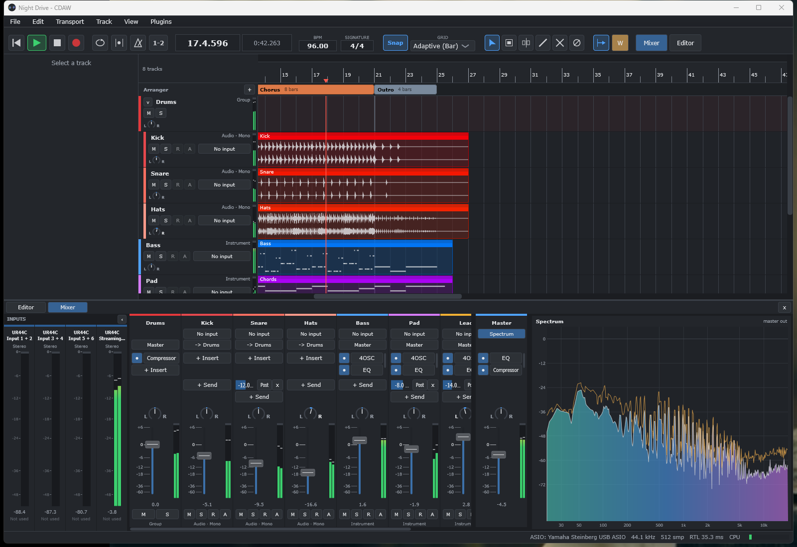
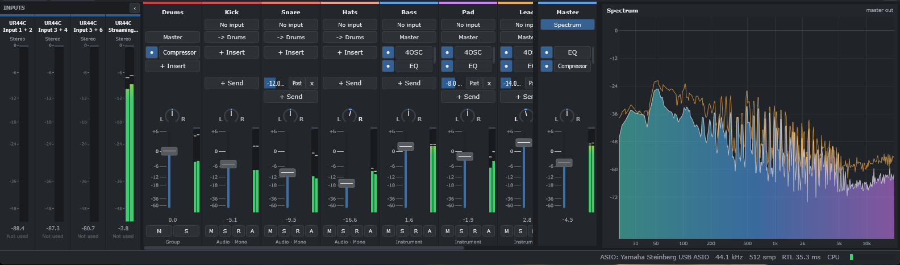
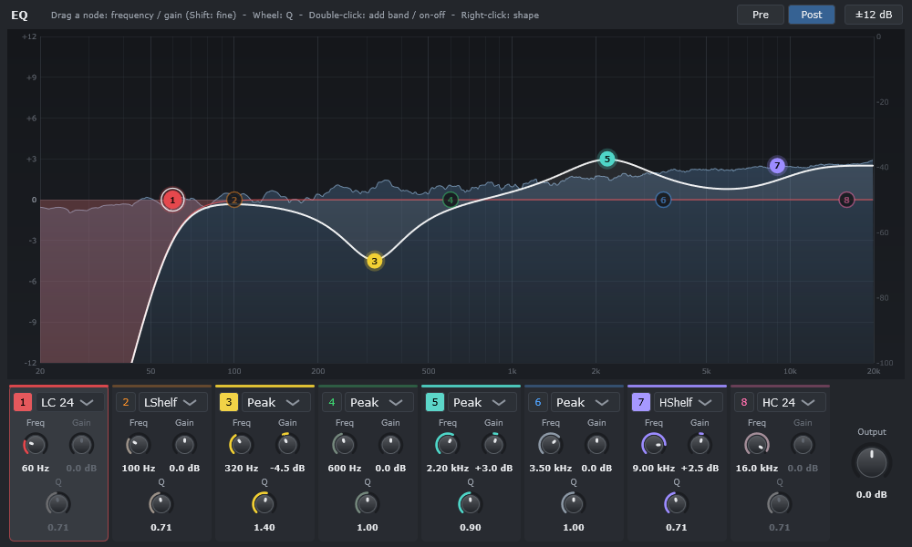
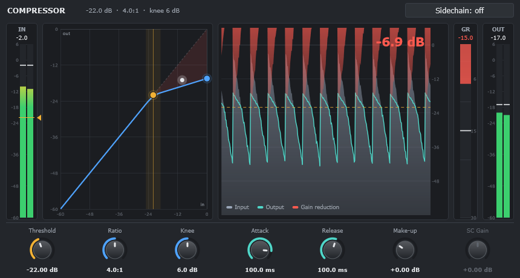
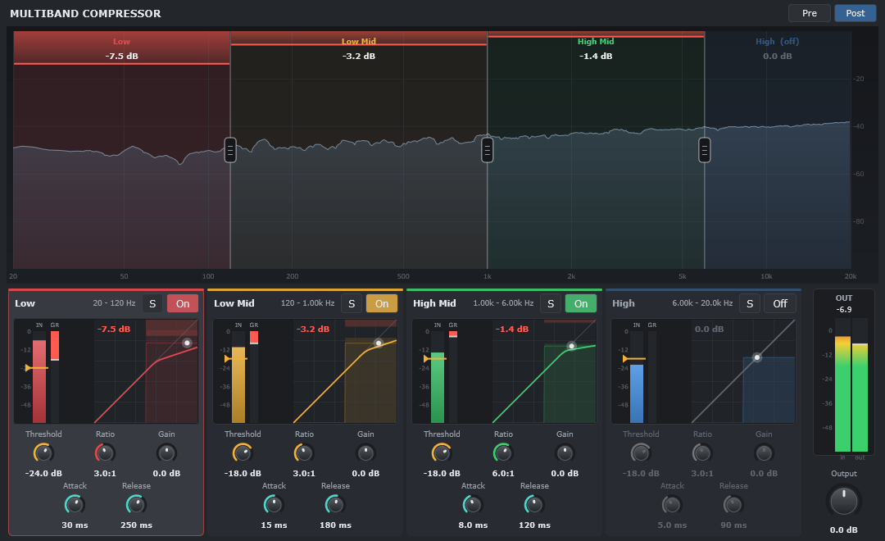
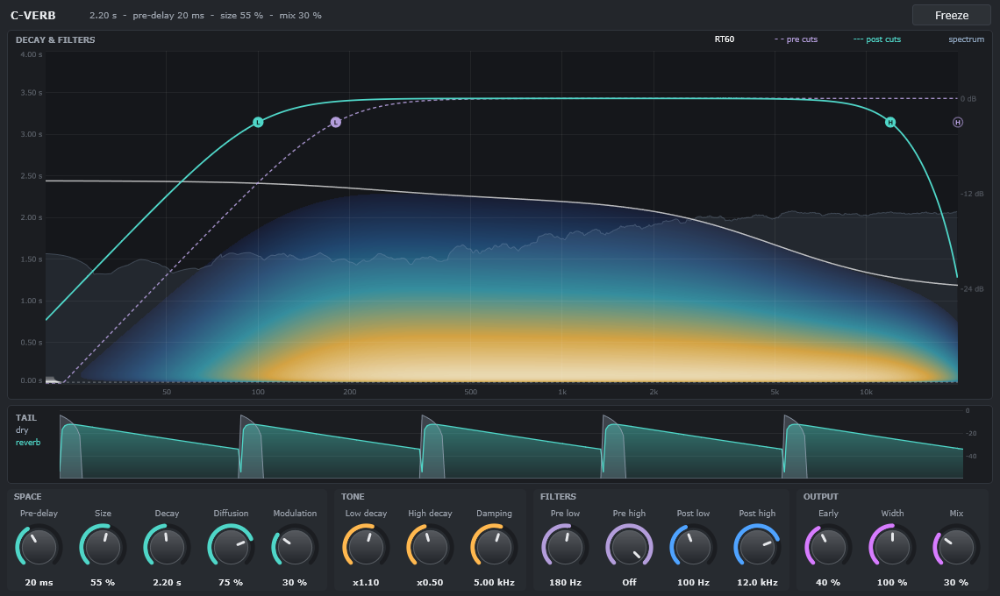
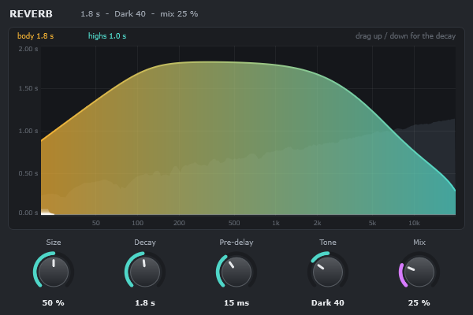
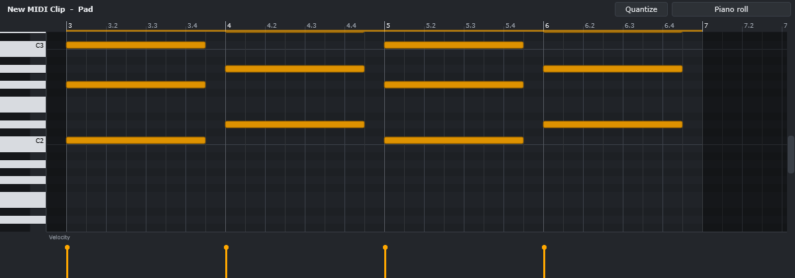
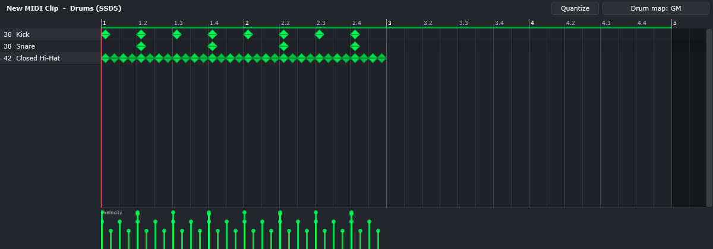

# CDAW

A native Windows DAW for recording, songwriting, MIDI production, editing and mixing.
Built in C++20 on [JUCE](https://juce.com) and [Tracktion Engine](https://github.com/Tracktion/tracktion_engine).



## Features

**Recording**
- ASIO and Windows Audio (WASAPI); ASIO is picked by default when present.
- Audio and MIDI recording with punch in / out, count-in, metronome, and loop recording into take lanes with swipe comping.
- Record arm, input choice and monitor modes per track; latency shown in the status bar.
- Mono and stereo audio tracks: a mono track records one input channel and plays it centred (pannable), a stereo track records an input pair. Inputs are paired and split as you choose them.

**Arranging and editing**
- Audio, instrument, FX, group and folder tracks.
- Clips: move, copy, trim, split, duplicate, slip edit, clip gain, fades with selectable shapes, crossfades, looped MIDI clips.
- Arranger track with song sections (Intro, Verse, Chorus...) that move, copy and repeat everything in their range.
- Piano roll and drum editor with drum maps; MIDI import and export.
- Automation lanes (draw, edit, bend; Read / Touch / Latch / Write), tempo and time-signature changes, markers.
- Undo (200 steps), autosave and crash recovery.
- Audio that has moved is found again when a project opens; anything still missing is reported and can be pointed at by hand.

**Mixing**
- VST3 instruments and effects, scanned out of process so a crashing plugin can't take CDAW down.
- Mixer with inserts, pre / post sends, FX returns, groups, master strip, level meters with dB scales and a spectrum analyser on the master.
- An Inputs section in the mixer shows the level of every audio input and which tracks use it.
- Sidechain for compressors.
- Built-in effects: 8-band EQ, compressor, multiband compressor, two reverbs (below).

**Exchange**
- Export mixdown and stems to WAV, FLAC, OGG and MP3; freeze tracks.
- [DAWproject](https://github.com/bitwig/dawproject) import and export, to move songs to and from Cubase, Bitwig, Studio One and others.
- C-Verb, the full reverb, and C-Multicomp, the multiband compressor, also build as VST3s for use in other DAWs.



## Example project

**Night Drive** is a one-minute synth-pop song in A minor at 96 BPM, made only from what ships with
CDAW: synthesised drum stems, 4OSC bass, pad and a supersaw lead, and the built-in EQ, compressor and
C-Verb. It shows song sections, a drum group with a compressor, an FX return and filter automation. It
isn't included in the repository; generate it with the test project:

```powershell
$env:CDAW_MAKE_EXAMPLE = "$env:USERPROFILE\Documents\CDAW Projects"
.\scripts\build.ps1 -Target CDAW_Tests -Test
```

Then open `Night Drive.cdaw` in CDAW. A preview mixdown is written to its `Bounces` folder.

## Built-in effects

| | |
|---|---|
| **EQ**: 8 bands (low / high cut at 6-48 dB/oct, shelves, peak, notch) drawn over a live spectrum. Drag a node for frequency and gain, mouse wheel for Q. |  |
| **Compressor**: soft knee, sidechain, input / output / gain-reduction meters, the transfer curve with a live dot and a scrolling level history. |  |
| **C-Multicomp**, the multiband compressor: 4 bands with phase-aligned 24 dB/oct crossovers you drag on a live spectrum; a compressor, solo and bypass per band, gain reduction per band. |  |
| **C-Verb**: early reflections, diffusion and an 8-line modulated delay network with separate decay times for lows, mids and highs; pre-delay, width, freeze, and low / high cuts before and after the reverb. The decay map shows how long each frequency rings. |  |
| **Reverb**: the quick one, with the same engine as C-Verb behind five controls: size, decay, pre-delay, tone and mix. |  |

<details>
<summary>Piano roll and drum editor</summary>




</details>

## Status

Built and checked by an automated test suite (400+ checks: engine, editing, recording plumbing,
DSP accuracy of the built-in effects, DAWproject round trips, UI snapshots) and launch tests on a
Steinberg UR44C.

**Not yet verified on real hardware**: live recording and monitoring latency, loop-take capture,
USB keyboard into drum and synth plugins, multi-output drum routing. See `docs\manual-tests.md`.

**Not built**: multi-output instrument routing into separate mixer channels, MIDI learn, CC lanes in
the piano roll, an audio time-stretch UI, a clip launcher, control surfaces.

## Getting started

### Prerequisites (one time)

```powershell
.\scripts\setup-toolchain.ps1   # MSVC Build Tools 2022, CMake, Ninja (accept the admin prompt)
.\scripts\bootstrap.ps1         # Tracktion Engine (pinned) + JUCE submodule
```

You don't need the Visual Studio IDE: the Build Tools package is only the compiler and the Windows SDK.

### Build and run

Double-click `Build-CDAW.bat`: it builds CDAW and the C-Verb and C-Multicomp VST3s and puts them in `dist\`.
Start `dist\CDAW\CDAW.exe`.

Or from PowerShell:

```powershell
.\scripts\build.ps1                         # RelWithDebInfo (the build that ships)
.\scripts\build.ps1 -Target CDAW_Tests -Test   # build and run the automated tests
.\scripts\build.ps1 -Preset ninja-msvc-debug
.\build\ninja-msvc-relwithdebinfo\Source\CDAW_artefacts\RelWithDebInfo\CDAW.exe
```

The first build compiles all of JUCE and Tracktion Engine and takes a while; later builds are
incremental. VS Code with the CMake Tools extension picks up `CMakePresets.json` directly.

## Where things live

| What | Where |
|---|---|
| App settings, key mappings, recent projects | `%APPDATA%\CDAW\CDAW.settings` |
| Engine settings, audio device, plugin list | `%APPDATA%\CDAW\Settings.xml` |
| Logs | `%APPDATA%\CDAW\Logs` |
| Crash reports | `%APPDATA%\CDAW\Crashes` |
| Your drum maps | `%APPDATA%\CDAW\DrumMaps\*.txt` |
| Projects (default) | `Documents\CDAW Projects\<Song>\` |

A project is a folder holding `<Song>.cdaw`, an `Audio\` folder with recordings and imported
files, `Bounces\`, `MIDI\`, `Backups\` and a `Cache\` folder that is safe to delete. The `.cdaw`
file is Tracktion Engine's edit XML under CDAW's own extension. Projects from earlier builds
(`<Song>.tracktionedit`) are converted when opened, and the old file is moved to `Backups\`.
CDAW registers `.cdaw` with Windows for the current user, so double-clicking a project opens it.

## DAWproject

**File > Export DAWproject...** writes the open project as a `.dawproject` (format 1.0): one zip
holding the arrangement, the mixer, the audio files and each VST3 plugin's settings as a
`.vstpreset`. **File > Import DAWproject...** creates a new CDAW project from one, extracting its
audio into `Audio\Imported\`.

What carries over both ways:
- Tracks: audio, instrument, FX returns, groups and folders, with names and colours.
- Mixer: volume, pan, mute, solo, routing into groups, and pre / post sends.
- Audio clips with offset and fades, and MIDI clips with notes and loop range.
- VST3 plugins with their full state. The built-in compressor and EQ map to the format's generic
  Compressor and Equalizer.
- Volume, pan and plugin automation.
- Tempo and time-signature changes, and markers.

Some things have no equivalent in the format: clip gain, reversed clips, clip speed, takes,
sidechain routing, and the other built-in effects. Song sections are exported as markers. VST2,
CLAP and AU plugins aren't supported on import, and a plugin that isn't installed is skipped.
All of these are listed in a report after each import or export.

## C-Verb and C-Multicomp as VST3s

C-Verb and C-Multicomp also build as VST3s (`C-Verb.vst3`, `C-Multicomp.vst3`) for Cubase and other
hosts. `Build-CDAW.bat` builds them, and `scripts\publish.ps1` puts them in `dist\VST3` and installs them in
`C:\Program Files\Common Files\VST3\CDAW`, the folder hosts scan for VST3 plugins (Windows asks for
administrator approval once; if you decline, it goes to `%LOCALAPPDATA%\Programs\Common\VST3\CDAW`
instead). In Cubase, open Studio > VST Plug-in Manager and rescan (or restart Cubase); C-Verb appears
under Reverb and C-Multicomp under Dynamics. Close Cubase before publishing, as it keeps loaded
plugins locked.

Each plugin's CDAW build and VST3 compile the same code in `Source\Shared`, so a change there
applies to both:

| | DSP | Parameters | Editor | CDAW glue | VST3 glue |
|---|---|---|---|---|---|
| C-Verb | `ReverbEngine` | `CVerbParameters` | `CVerbView` | `ReverbPlugin`, `ReverbEditor` | `VST3\CVerb\CVerbProcessor.*` |
| C-Multicomp | `MultibandEngine` | `MultibandParameters` | `MultibandView` | `MultibandPlugin`, `MultibandEditor` | `VST3\CMulticomp\CMulticompProcessor.*` |

A test per plugin loads the built VST3 and checks it produces the same audio as CDAW's. Parameter
IDs are saved in projects and presets: never change them.

## MP3 export

MP3 encoding uses LAME, loaded at runtime. Put `libmp3lame.dll` (64-bit) next to `CDAW.exe` to
enable the MP3 option in the export dialog. CDAW doesn't include LAME.

## Repository layout

| Folder | What |
|---|---|
| `Source\App` | Application, main window, menus and commands, settings, crash handler |
| `Source\Engine` | Tracktion Engine setup, audio devices, plugin windows, master analyser |
| `Source\Model` | Project, tracks, clips, mixer, automation, tempo, arranger, DAWproject |
| `Source\Plugins` | Built-in effects as Tracktion plugins |
| `Source\Shared` | Code without Tracktion, shared with the VST3 build: DSP, knobs, C-Verb, C-Multicomp |
| `Source\UI` | Arrangement, mixer, piano roll, inspector, plugin editors, look and feel |
| `VST3\CVerb`, `VST3\CMulticomp` | The C-Verb and C-Multicomp VST3s (host glue only) |
| `Tests` | Automated tests (`CDAW_Tests`); `CDAW_SNAPSHOTS=1` also renders the UI to PNGs |
| `scripts` | Toolchain setup, bootstrap, build and publish |
| `third_party\tracktion_engine` | Tracktion Engine and JUCE (git submodule) |

## Updating Tracktion Engine

The engine is pinned in `scripts\bootstrap.ps1`. To update, change the commit there, rerun the
script, read `third_party\tracktion_engine\BREAKING-CHANGES.md`, rebuild and run the tests.

## Troubleshooting

- **No ASIO device / device busy**: close other DAWs. Usually only one app can use an ASIO driver.
  If your interface can't be opened at startup, CDAW uses another device for that session, says so
  in the status bar, and tries your interface again next time.
- **Doubled dry guitar while monitoring**: turn off direct monitoring in dspMixFx.
- **A plugin crashed CDAW**: on the next start CDAW offers to disable it. Re-enable it in
  Preferences > Plugins.
- **Crackles at small buffer sizes**: use the RelWithDebInfo or Release build, the High
  Performance power plan, and turn off USB selective suspend.

## Licence

Copyright (C) 2026 Cyrill Durrer

CDAW, including the C-Verb and C-Multicomp VST3s, is free software: you can redistribute it and/or modify it under
the terms of the **GNU Affero General Public License** as published by the Free Software Foundation,
either version 3 of the License, or (at your option) any later version. See [LICENSE](LICENSE).

CDAW is distributed in the hope that it will be useful, but WITHOUT ANY WARRANTY; without even the
implied warranty of MERCHANTABILITY or FITNESS FOR A PARTICULAR PURPOSE. See the GNU Affero
General Public License for more details.

### Third-party software

CDAW is built on these open-source projects. Each keeps its own licence; the licence files are in
`third_party\tracktion_engine` (a git submodule).

| Project | Licence | Used for |
|---|---|---|
| [JUCE 8](https://github.com/juce-framework/JUCE) | AGPLv3 (or the commercial JUCE licence) | Application framework, audio devices, plugin hosting, UI, the VST3 build |
| [Tracktion Engine](https://github.com/Tracktion/tracktion_engine) | GPLv3 or later (or a commercial licence) | Audio engine: edits, playback, recording, rendering |

Included through JUCE:

| Component | Licence |
|---|---|
| Steinberg VST3 SDK | MIT |
| Steinberg ASIO SDK | GPLv3 (or Steinberg's proprietary ASIO licence) |
| FLAC | BSD |
| Ogg Vorbis | BSD |
| zlib | zlib |
| libpng | zlib / libpng |
| jpeglib | Independent JPEG Group licence |
| HarfBuzz | Old MIT |
| SheenBidi | Apache 2.0 |

Included through Tracktion Engine:

| Component | Licence |
|---|---|
| SoundTouch | LGPL 2.1 |
| Signalsmith Stretch | MIT |
| Airwindows | MIT |
| CHOC | ISC |
| crill | Boost Software License 1.0 |
| farbot | MIT |

Not included:
- **LAME** (LGPL) is not shipped. MP3 export loads a `libmp3lame.dll` you provide.
- **DAWproject** is an open format by Bitwig (MIT). CDAW implements the format and includes none
  of its code.

VST is a registered trademark of Steinberg Media Technologies GmbH. ASIO is a trademark and
software of Steinberg Media Technologies GmbH. Cubase is a trademark of Steinberg Media
Technologies GmbH. Other product names are trademarks of their owners.
